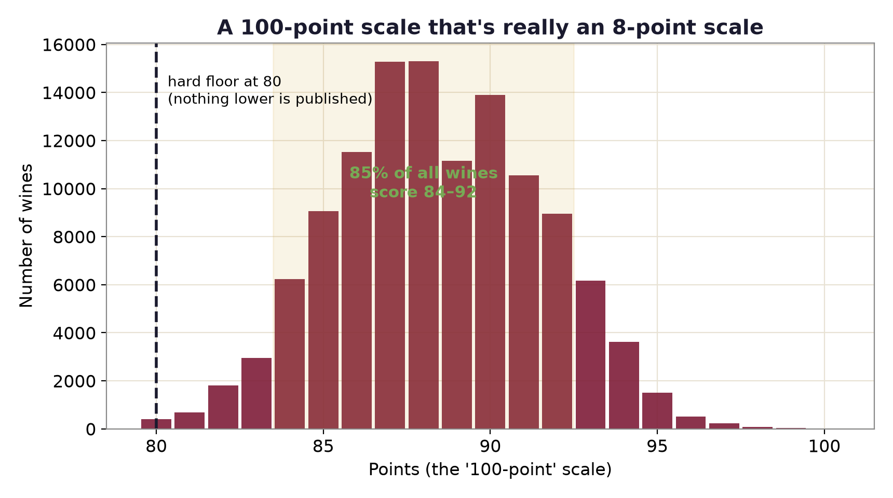

# Wine Score Inflation

A data study of 129,971 Wine Enthusiast reviews showing that the 100-point wine scale is, in practice, about eight points wide.

[Live site](https://lyhjeremy.github.io/wine-score-inflation/) · [Write-up](https://lyhjeremy.github.io/wine-score-inflation/overview/)

Design and copy follow [these standards](https://github.com/lyhjeremy/lyhjeremy/blob/main/DESIGN_STANDARDS.md).

## Results

| Measure | Value |
|---|---|
| Lowest published score | 80 |
| Share of wines scoring 84 to 92 | 85.7% |
| Points against log price | r = 0.61 |
| Average at about $10 / about $100 | 85.3 / 91.9 points |
| Vintage trend, 1995 to 2016 | 0.09 points per decade |
| Spread between the ten most prolific tasters | 3.1 points (86.9 to 90.0) |



## Method

`analyze.py` loads the reviews with pandas, coerces points and price to numbers, and pulls the vintage year out of each title with a regular expression. It then computes four things:

1. The score distribution: minimum, mean, median and the share of wines from 84 to 92.
2. Price against points: the Pearson correlation of points with log10 price for wines from $4 to $500, the mean score at $9 to $11 and at $90 to $110, and a curve over 20 equal-count price bins.
3. Vintage: mean score per vintage from 1995 to 2016 and a linear fit (`scipy.stats.linregress`) through those means.
4. Tasters: the mean score of each of the ten tasters with the most reviews.

Every number above is written to `tables/summary.csv` and drawn in `figures/`.

Stack: Python, pandas, NumPy, SciPy, matplotlib.

## How to run

```bash
pip install -r requirements.txt
python fetch_data.py     # downloads the ~130k-review CSV to data/ (git-ignored)
python analyze.py        # writes figures/ and tables/summary.csv
```

## Repo layout

| Path | Contents |
|---|---|
| `fetch_data.py` | Downloads `winemag-data-130k-v2.csv` |
| `analyze.py` | All statistics and figures |
| `figures/` | The four charts used on the site |
| `tables/summary.csv` | The headline numbers |
| `index.html`, `overview/` | The published story and write-up |

## Limitations

The data is the public `winemag-data-130k-v2` set (Kaggle, through a GitHub mirror): one snapshot from one publication, with no review dates. It cannot show scores creeping upward over time. The inflation it measures is structural: an 80 floor and a narrow band, plus the price, vintage and taster effects inside that band. Wines whose titles carry no year drop out of the vintage chart only. Taster means are raw, so they mix taster generosity with the regions and price points each taster covers.

## License

[MIT](LICENSE) © 2026 Jeremy Lee
